  

 

  <h1>👋 Hi, I'm Rudra Protap Chakraborty</h1>
  <h3>Full Stack Web Developer &nbsp;·&nbsp; I build fast, SEO-friendly websites & web apps for businesses</h3>
   
  
  &nbsp;
  
  &nbsp;
  

 

---

## 📝 About Me

  From 2025 to 2026 I built production websites for agency clients at <b>Creative Surf</b>: 
  real estate, hospitality, film production and marketing. Next.js and TypeScript 
  on the front end, Node.js and MongoDB behind it. 
   
  The work I enjoy most sits where design meets engineering: WebGL interfaces, 
  bilingual content systems and admin panels that let clients run their own sites. 
  Studying physics is where my habit of questioning my own assumptions comes from.

---

## 🚀 Featured Client Work

| Project | What it is | Built with |
|---|---|---|
| **[BeeTeam Studios](https://www.beeteamltd.com/)** | Cinematic website for a Dhaka film production studio | Next.js · React · Tailwind CSS |
| **[Creative Surf Agency](https://www.creativesurf.agency/)** | Agency website for a digital creative studio | Next.js · React · Tailwind CSS |
| **[Spring Field Developments](https://springfield-developments.vercel.app/)** | Corporate site for a real estate developer with 100+ completed projects | Next.js · React · Tailwind CSS |
| **[SEZA Design & Construction](https://sezadc.vercel.app/)** | Bilingual (English / Bangla) site for a design and construction firm | Next.js · TypeScript · Tailwind CSS |
| **[Nami Moon Restaurant](https://nami-moon.vercel.app/)** | Restaurant website for a Pan-Asian dining spot in Dhaka | Next.js · React · Tailwind CSS |
| **[Sirius A Marketing](https://sirius-a-marketing.vercel.app/)** | Website for a marketing agency with offices in the UK and Bangladesh | Next.js · React · Tailwind CSS |
| **[Wedvisa](https://wedvisa-planning.vercel.app/)** | Wedding planner dashboard for budgets, guests and suppliers | Next.js · TypeScript · Tailwind CSS |

Client code is private. Case studies with screenshots: <a href="https://rudraprotapchakraborty.com/projects">rudraprotapchakraborty.com/projects</a>

---

## 🧪 Personal Projects

| Project | What it is | Code |
|---|---|---|
| **[Digital Wallet System](https://digital-wallet-system-frontend-topaz.vercel.app/)** | Digital wallet with role-based sign-in, transfers and admin controls | [frontend](https://github.com/rudraprotapchakraborty/digital-wallet-system-frontend) · [backend](https://github.com/rudraprotapchakraborty/digital-wallet-system-backend) |
| **[Travel Buddy](https://travel-buddy-frontend-qzgv.vercel.app/)** | Find travel companions, share trip plans and organize meetups | [frontend](https://github.com/rudraprotapchakraborty/travel-buddy-frontend) · [backend](https://github.com/rudraprotapchakraborty/travel-buddy-backend) |
| **[Hotel Management System](https://hotel-management-system-frontend-lac.vercel.app/)** | Hotel dining and membership: menu, cart, card and SSLCommerz payments, reviews | [frontend](https://github.com/rudraprotapchakraborty/hotel-management-system-frontend) · [backend](https://github.com/rudraprotapchakraborty/hotel-management-system-backend) |
| **[Food Sharing](https://food-sharing-platform-frontend-chi.vercel.app/)** | Share surplus food, request a meal and cut waste | [frontend](https://github.com/rudraprotapchakraborty/food-sharing-platform-frontend) · [backend](https://github.com/rudraprotapchakraborty/food-sharing-platform-backend) |
| **[Movie Portal](https://movie-portal-frontend-tau.vercel.app/)** | Movie catalogue with search, genres, favorites and member-added movies | [frontend](https://github.com/rudraprotapchakraborty/movie-portal-frontend) · [backend](https://github.com/rudraprotapchakraborty/movie-portal-backend) |
| **[Realtime Task Board](https://realtime-task-board-frontend.vercel.app/)** | Kanban board with drag and drop, live sync across devices and secure sign-in | [frontend](https://github.com/rudraprotapchakraborty/realtime-task-board-frontend) · [backend](https://github.com/rudraprotapchakraborty/realtime-task-board-backend) |
| **[Inkwell](https://inkwell-blog-platform-lyart.vercel.app/)** | Blog writing platform: write, draft and publish posts with a rich-text editor, likes and comments | [full-stack](https://github.com/rudraprotapchakraborty/inkwell-blog-platform) |

---

## 💼 Need a Website?

  I build business websites, web apps and admin dashboards, and I can set up the domain and hosting too. 
  <a href="https://rudraprotapchakraborty.com/services"><b>See services</b></a> &nbsp;·&nbsp; <a href="https://rudraprotapchakraborty.com/contact"><b>Start a project</b></a>

---

## 📌 Currently

| | What I'm up to |
|---|---|
| 💼 | Taking on freelance website and web app projects, and open to remote roles |
| 🗄️ | Deepening backend expertise with **PostgreSQL**, **Prisma ORM**, and **Express.js** |
| 🚀 | Exploring **Docker** and **AWS** for scalable deployments |
| 🎓 | Pursuing a BSc in Physics at Amity University, Kolkata (2024–2028) |

---

## 🖥️ Tech Stack

**Frontend**

 

**Backend & Database**

 

**Tools & Deployment**

---

## 📊 GitHub Stats

 

  

 

 

  

---

## 📬 Reach Me Out

 

  
  &nbsp;&nbsp;
  
  &nbsp;&nbsp;
  

 
